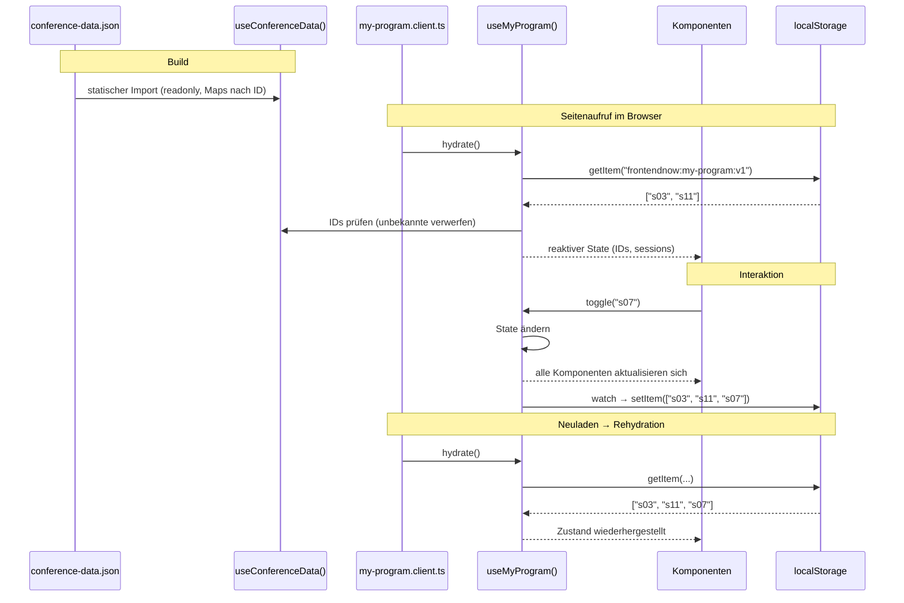

# C. State-Management-Konzept: „Mein Programm“ & conference-data.json

Wir unterscheiden zwei Arten von Zustand: den **geteilten Datensatz**, der für alle
gleich und schreibgeschützt ist, und den **persönlichen Zustand** „Mein Programm“,
der nur im Browser der Besucher\*innen existiert. Beide werden über je ein
Composable bereitgestellt (siehe Architektur-ADR). Ein eigener Store wie Pinia ist
für diesen kleinen, klar umrissenen Zustand nicht nötig (siehe Technologie-ADR).

## Wie wird der geteilte Datensatz geladen/modelliert? 

`useConferenceData()` importiert `../../src/data` statisch. Die Daten
werden dadurch beim Build mitgeliefert. Es gibt keinen Netzwerkaufruf zur
Laufzeit, und der Datensatz ist automatisch offline verfügbar, sobald die App
gecacht ist.

Modelliert wird der Datensatz mit TypeScript-Typen (`types/conference.ts`) passend
zum Schema. Das Composable gibt die Daten **schreibgeschützt** (`readonly`) zurück
und bietet Lookups über IDs (`getSession(id)`, `getSpeaker(id)`, `getTrack(id)`,
`getRoom(id)`) sowie abgeleitete Abfragen wie `getSessionsBySpeaker(id)`. Intern
werden dafür einmalig Maps nach ID aufgebaut, damit Komponenten nicht selbst in
Arrays suchen.

## Wie wird der personalisierte State für „Mein Programm“ verwaltet und in localStorage persistiert?

`useMyProgram()` hält den Zustand in `useState('my-program')` von Nuxt. Komponenten
ändern ihn nie direkt, sondern nur über Aktionen: `add(id)`, `remove(id)`,
`toggle(id)`. Nach außen gibt das Composable den Zustand nur lesend heraus.

Persistiert wird unter dem Schlüssel `frontendnow:my-program:v1`. Die Versionsnummer
im Schlüssel erlaubt später eine Änderung des Formats, ohne dass alte Einträge die
App stören. Der Zugriff auf `localStorage` passiert **nur in diesem Composable**.

## Datenstruktur (nur IDs vs. volle Objekte)?

Gespeichert werden **nur die Session-IDs** als Array, z. B. `["s03", "s11"]`.

- Klein und einfach als JSON zu speichern
- Keine doppelten Daten: Titel, Raum oder Uhrzeit kommen immer aus dem Datensatz.
  Ändert sich eine Session (relevant für die Rendering-Frage in Schritt 2), zeigt
  „Mein Programm“ automatisch die aktuelle Version.
- Die vollen Objekte werden bei Bedarf abgeleitet: Ein `computed` löst die IDs über
  `useConferenceData()` auf und sortiert sie nach Tag und Uhrzeit.

## Wann geladen/synchronisiert?

- **Datensatz:** beim Build, ist sofort beim Seitenaufruf da.
- **Rehydration:** Beim Prerender auf dem Server ist „Mein Programm“ leer.
  Im Browser liest ein Client-Plugin (`plugins/my-program.client.ts`) nach dem
  Start einmalig `localStorage` aus und ruft dafür `useMyProgram().hydrate()` auf.
  Dabei werden IDs verworfen, die es im Datensatz nicht mehr gibt.
- **Speichern:** Ein `watch` auf den Zustand schreibt nach jeder Änderung sofort in
  `localStorage`.
- **Mehrere Tabs:** Über das `storage`-Event übernimmt ein zweiter Tab
  Änderungen aus dem ersten.

## Wie reaktiv an mehrere Komponenten verteilt?

`useState` liefert unter demselben Schlüssel überall **dieselbe reaktive Referenz**.
Merkt man ein Event im Timetable der Programmübersicht, zeigen sofort auch der
`MyProgramToggle` auf der Infokarte des Events, die Vortragsliste auf der Infokarte
des Speakers und `MyProgramTimetable` den neuen Zustand.
Abgeleitete Werte (`sessions`, `conflicts`, `isInProgram(id)`) sind
`computed` und werden nur bei Änderungen neu berechnet.

**Filter:** Programmübersicht und „Mein Programm“ lassen sich nach denselben
Kriterien filtern (Raum, Tag, Track, Level, Uhrzeit, Speaker). Dafür bekommt
`useSessionFilter(sessions)` die jeweilige Liste übergeben: alle Sessions aus
`useConferenceData()` oder die gemerkten aus `useMyProgram()`. Der Filterzustand
ist bewusst **getrennt** von „Mein Programm“. Er steht in der URL-Query statt im
`localStorage`, sodass Filtern nie die gemerkten IDs verändert.

## Datenfluss-/Sequenzdiagramm

