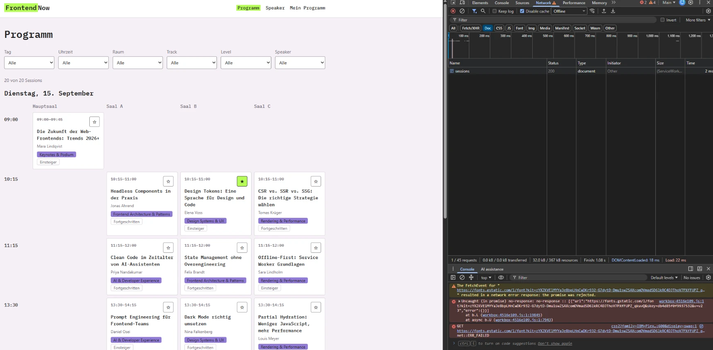
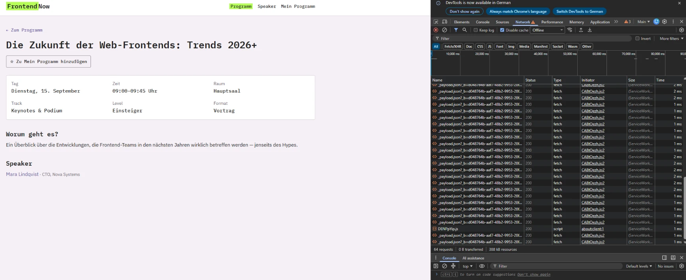
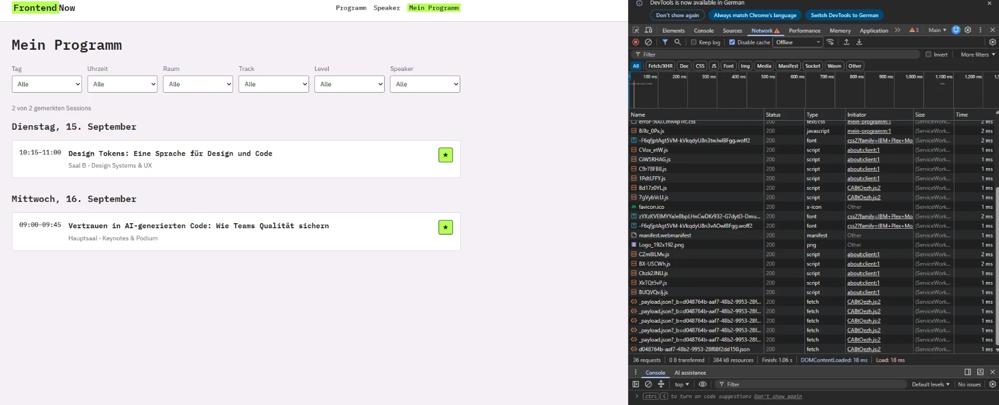
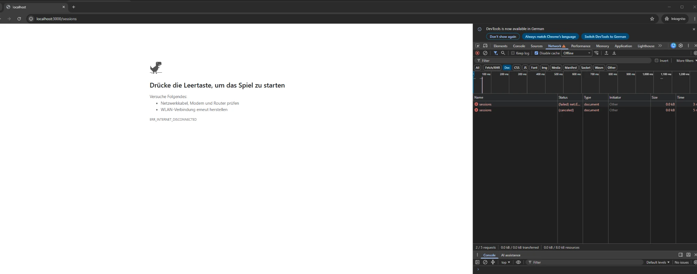
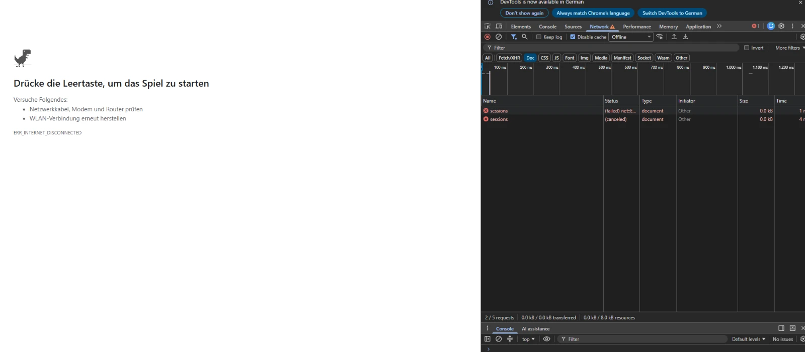
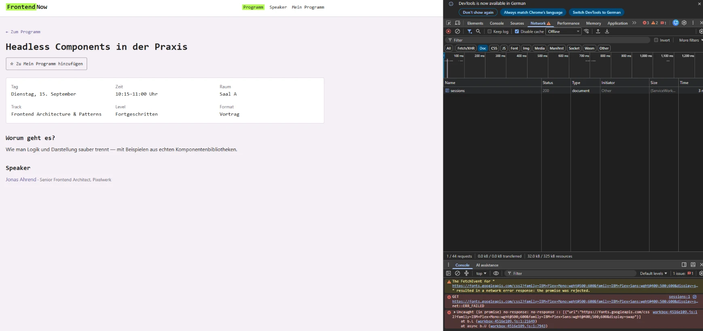
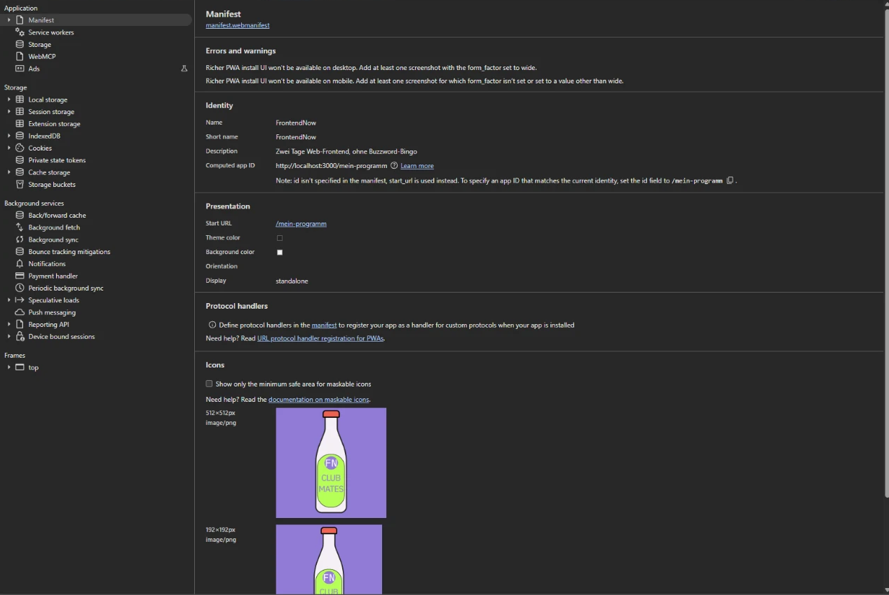
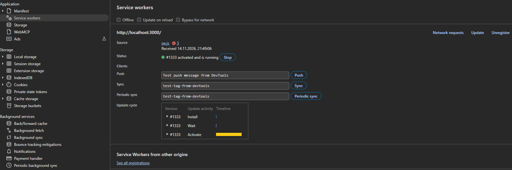
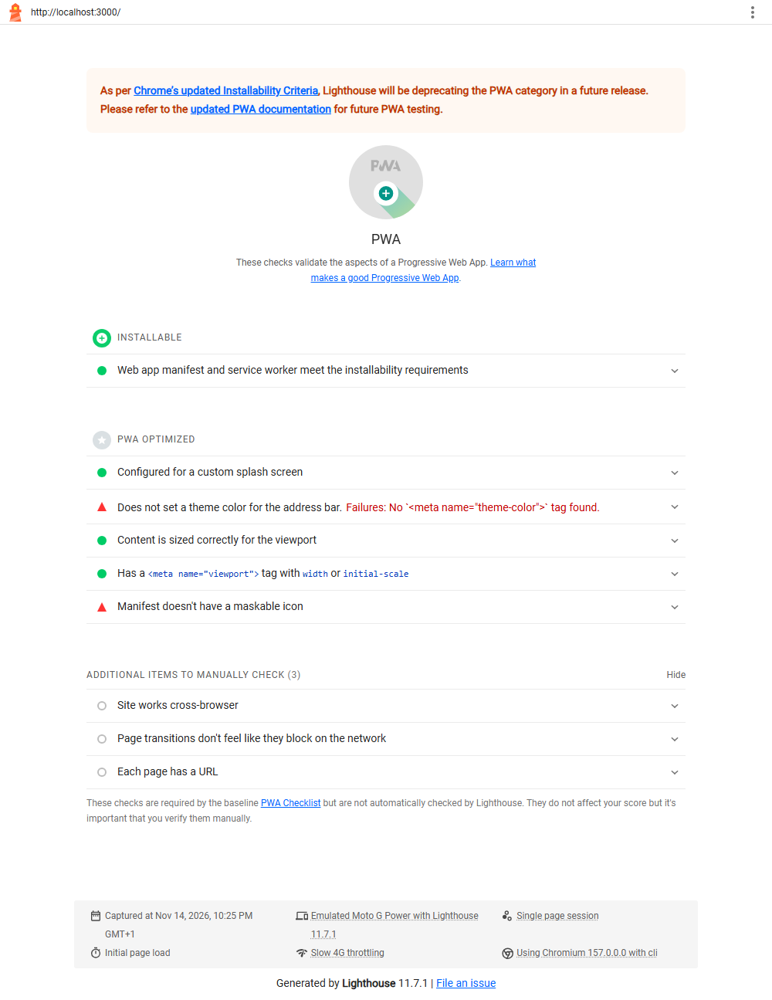

# Verifikations-Nachweis

## Testaufbau

- Browser: Google Chrome 157 unter Windows 11 (Rechner Person 2)
- Build: `npm run generate`, ausgeliefert mit `npx serve .output/public` (im Dev-Modus ist der Service Worker aus)
- Chrome-DevTools: Network-Tab mit „Offline“, Application-Tab, Lighthouse 11.7.1 (`npx lighthouse@11`)
- Vor jedem Offline-Test: Application → Service Workers zeigt „activated and is running“

## Belege

| Szenario (D) | Beleg | Ergebnis |
|---|---|---|
| i. Programm offline erneut öffnen |  | `sessions` nach F5: 200, Quelle ServiceWorker, 0 kB übertragen |
| i. Detailseite offline |  | Alle `_payload.json` mit 200 aus dem Precache |
| ii. „Mein Programm“ offline |  | 2 von 2 gemerkten Sessions sichtbar |
| iii. Erstbesuch offline |  | Browser-Fehlerseite, kein Service Worker vorhanden |
| iii. Erstbesuch über 3G, zu früh offline |  | Browser-Fehlerseite, Precache nicht fertig |
| iii. Nach vollständigem Erstbesuch |  | App lädt offline aus dem Service Worker |
| Manifest-Validität |  | Name, Start-URL, Farben, `standalone`, Icons 192 und 512 |
| Service-Worker-Erkennung |  | `sw.js` „activated and is running“ |
| Installierbarkeit |  | „Installable“ bestanden ([vollständiger Bericht](assets/lighthouse-pwa-report.html)) |

## Einordnung

Getestet wurde der gebaute Stand im Chrome-Offline-Modus, jeweils nach F5 und beim
Weiterklicken in der App. Jedes Szenario ist mit mindestens einem DevTools-Screenshot
belegt, die Tabelle oben ordnet sie zu. Szenario i und ii zeigen, dass Cache-First wie in Konzept B
geplant greift: Seiten, Bundle und Seitendaten kommen ohne Netz aus dem Precache, die
gemerkten Sessions aus dem `localStorage`. Lighthouse bestätigt Installierbarkeit,
gültiges Manifest und einen erkannten Service Worker.

Dabei sind Lücken aufgefallen. Die Seitendaten (`_payload.json?_b=…`) verfehlten
zunächst den Precache und schlugen offline fehl, behoben über `ignoreURLParametersMatching`.
Szenario iii zeigt die Grenze: Ohne vollständigen ersten Online-Besuch gibt es keinen
Offline-Modus. Über 3G dauert die Installation länger als das Laden der Seite, und ein
Abbruch verwirft sie ganz. Das stützt die Empfehlung, die App vor der Konferenz zu
öffnen. Die Google-Fonts werden nur zur Laufzeit gecacht und fehlen offline teilweise,
dann greift eine Systemschrift. Lighthouse meldet außerdem ein fehlendes
`theme-color`-Meta-Tag und kein maskable Icon. Firefox und Safari wurden nicht getestet.
